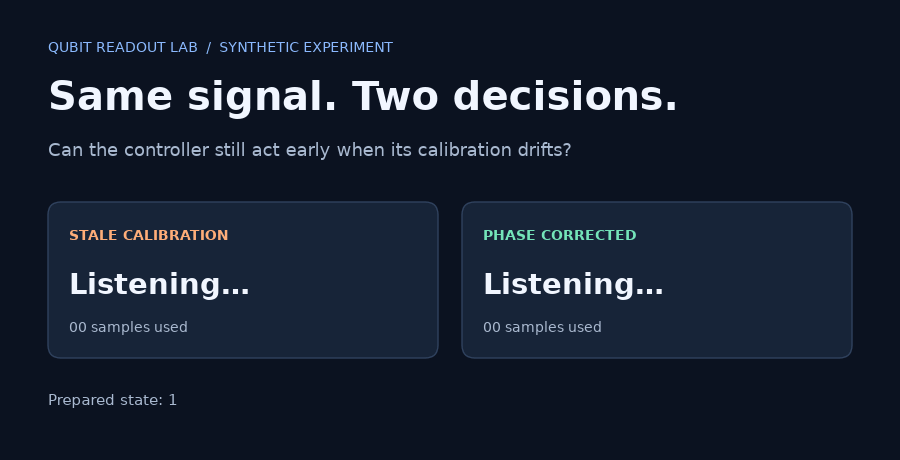

# Signal / State · Qubit Readout Lab

**How early can a controller trust a qubit readout?**

[**Launch the interactive exhibit ↗**](https://hanshengzhu0001.github.io/qubit-readout-lab/)

A controller needs to read a qubit before it can act on the result. Waiting for more samples costs time. Acting early can save time, but if the measurement electronics drift, the controller can become confident in the wrong answer.

[](https://hanshengzhu0001.github.io/qubit-readout-lab/)

**What can 16 labeled calibration shots buy you?** In this synthetic experiment, fitting one phase offset cut early-readout errors from **339 to 16 out of 4,000**. The corrected rule still used just **18.64 of 48 samples** on average.

[Replay the experiment](#replay-the-experiment) · [How Rust async works here](#rust-async-two-runtimes-two-jobs) · [Reproduce the results](#reproduce-locally)

## A small inverse problem before each readout experiment

The idea comes from two prior projects. Single-image scene reconstruction uses an observation to infer hidden structure. Inverse-PDE work uses known dynamics to constrain what can explain partial observations. Here the hidden quantity is a shared phase offset, and the forward model is a driven resonator. With eight labeled calibration shots per state, we fit one rotation by minimizing squared error between the predicted and measured I/Q trajectories. We then freeze it and evaluate on 4,000 separate shots.

| Condition at threshold 5 | Mean samples | Errors out of 4,000 |
|---|---:|---:|
| Nominal | 18.54 | 10 |
| 35° drift, stale calibration | 21.76 | 339 |
| 35° drift, fitted calibration | 18.64 | 16 |

The fitted angle was 42.99°. Even with that residual error, correction recovered most of the lost assignment accuracy in this seeded run. The experiment assumes one constant phase offset shared by pilot and evaluation shots. It does not establish robustness to drift within a run or other hardware effects.

The forward model solves a driven, damped linear resonator with state-dependent detuning. A Gaussian likelihood compares each new pair of voltages with the two predicted positions and accumulates evidence. Each comparison uses identical shots and noise across stopping rules. The two classes have equal prior probability. The fixed-window baseline uses the same likelihood at sample 48.

## Replay the experiment

[Open the interactive player](figures/readout-player.html). On GitHub, download the HTML and open it locally. Choose a calibration mode, stopping rule, and shot. Play or scrub to see the measured I/Q path, cumulative log odds, state decision, and simulated feedback time.

## Accuracy versus readout length


The chart changes the stopping threshold on the same shots. [Watch the evidence cross the decision threshold](figures/readout-replay.gif). For each curve, the rightmost point uses all 48 samples.

## Rust async: two runtimes, two jobs

**Tokio coordinates experiments. NeXosim schedules the events inside each experiment.**

- **Ownership and borrowing.** An immutable `Arc<Input>` shares the fixture among runs. Each bench borrows its shots and owns its actor state. The sample event moves its payload into the next scheduled event.
- **Tokio.** `JoinSet::spawn_blocking` runs independent synchronous benches while the async coordinator waits on an owned semaphore permit. At most two benches run concurrently.
- **NeXosim.** Its executor advances logical time one sample event at a time. The actor updates its log odds and schedules feedback once it hits the threshold or uses all 48 samples. Its output port sends the decision with `.await`. The illustrative timing uses a 4 ns sample period and 16 ns feedback delay.
- **Verification.** Rust fits the phase and checks each of 24,000 simulated decisions and feedback timestamps against a direct calculation. Python generates the fixture and compares aggregate accuracy and sample counts with its vectorized reference.

The data are synthetic and assume a fixed state within each shot, independent Gaussian noise, and a phase offset shared across pilot and test shots. The timing model processes one shot at a time.

## Reproduce locally

From the project directory, use Rust 1.93 and a Python environment:

```sh
python3 -m pip install -r requirements.txt
python3 scripts/readout.py
python3 scripts/animate.py
cargo test --locked
```

[Experiment data](figures/results.json) · [Inference and plotting](scripts/readout.py) · [Rust readout and Tokio runner](examples/readout.rs)

## Research context

Model-based readout optimization has been demonstrated on superconducting hardware. Sequential detection has also been evaluated offline on measured shots. This small experiment borrows those ideas to study calibration mismatch and feedback timing. [Bengtsson et al.](https://arxiv.org/abs/2308.02079) · [Johnson et al.](https://arxiv.org/abs/2610.00783)
