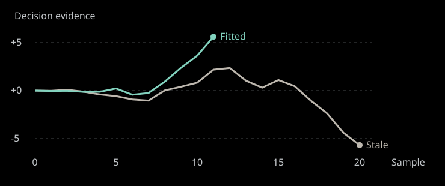
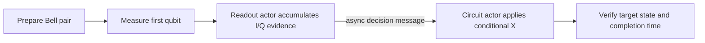
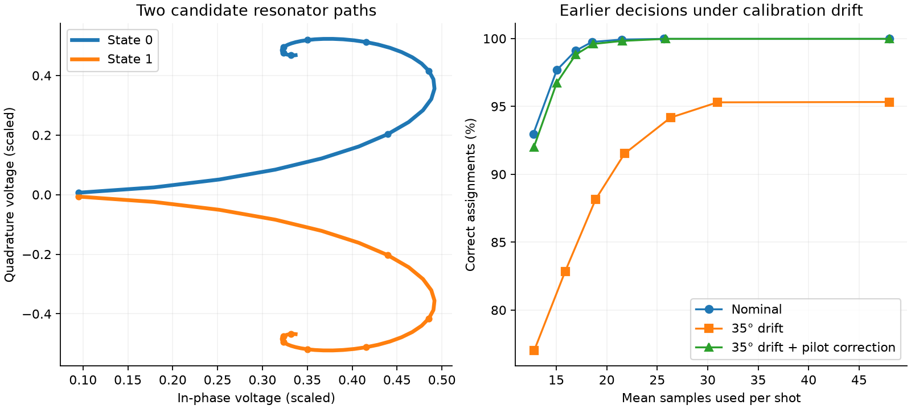

# Qubit Readout Lab

A Rust / NeXosim experiment in measurement-based feedback. A controller measures one qubit of a Bell pair and uses the result to reset its partner. When the microwave signal drifts, a missed **1** can make the controller skip a necessary flip.

[Interactive shot replay](https://hanshengzhu0001.github.io/qubit-readout-lab/) · [Circuit walkthrough](https://hanshengzhu0001.github.io/qubit-readout-lab/machine.html) · [Rust async implementation](#rust-async-two-runtimes-two-jobs)



**One shot, two decisions.** Both traces use the same noisy voltages. With the fitted reference, evidence reaches +5 at sample 11 and the controller flips the partner to zero. With stale calibration, evidence reaches −5 at sample 20 and the partner stays at one.

Across **4,000 matched synthetic shots** at 35° drift, fitting the reference with 16 labeled pilots increased correct resets within the modeled 120 ns deadline from **2,566 to 3,427**.

## What if calibration drifts again?

In a paired synthetic replay, the signal shifted by **50° after 1,856 evaluation shots**. The next periodic check detected the change after **64 more shots**. Recalibration improved correct, on-time resets from **1,087 to 1,843 out of 2,144** post-shift shots. The policy checks every 128 evaluation shots, using 16 labeled shots per check and refitting when the estimated phase differs by at least 18°. It uses **512 labeled shots total**, including the initial 16. Pilot acquisition time is outside the 120 ns per-shot budget.

The recovery experiment uses Python to replay the readout and feedback timing equations. The two-qubit circuit below and its event timing are modeled independently in Rust/NeXosim. [Explore the recovery timeline](https://hanshengzhu0001.github.io/qubit-readout-lab/drift.html) · [Experiment data](figures/drift-results.json)

## Why this is a real control problem

- **Readout takes time, and its accuracy depends on how it is configured.** Google Quantum AI experimentally optimized readout speed and error together for superconducting qubits. [Bengtsson et al., Model-based Optimization of Superconducting Qubit Readout](https://arxiv.org/abs/2308.02079)
- **Calibration can go stale.** An experimental superconducting logical-qubit study used labeled I/Q calibration data to fit prepared-state distributions and automated recalibration to counter control-parameter drift. [Ali et al., Reducing the Error Rate of a Superconducting Logical Qubit Using Analog Readout Information](https://doi.org/10.1103/PhysRevApplied.22.044031)

This lab isolates those concerns in an illustrative two-qubit feedback experiment. The abrupt 50° rotation, 120 ns deadline, pilot schedule, and recovery counts are simulation choices or outputs. They are not hardware measurements.

## From a quantum circuit to a classical decision and back

The simulator prepares a Bell pair from `|00⟩` with H and CNOT. Measuring the first qubit takes one of the two equally probable branches. The experiment explicitly supplies balanced branches so every calibration policy sees the same synthetic shots. A readout actor receives only the voltage-derived evidence. It sends its decision back to the circuit actor, which applies X to the second qubit if the controller reports 1, then checks its final state.



With an illustrative **120 ns deadline**, early readout reset the target correctly and on time in **2,566 / 4,000** drifted shots. Pilot correction raised that to **3,427 / 4,000**. The 48-sample policy finishes at 220 ns under the same timing model. The deadline scores the outcome and the circuit still finishes late shots.

This is a Bell-pair feedback experiment with an explicit two-qubit state vector and synthetic analog readout. H, CNOT, projective measurement, and conditional X are modeled directly. Shots run serially inside each bench. Tokio runs separate benches concurrently.

## A small inverse problem before each readout experiment

The idea comes from two prior projects. Single-image scene reconstruction uses an observation to infer hidden structure. Inverse-PDE work uses known dynamics to constrain what can explain partial observations. Here the hidden quantity is a shared phase offset, and the forward model is a driven resonator. With eight labeled calibration shots per state, we fit one rotation by minimizing squared error between the predicted and measured I/Q trajectories. We then freeze it and evaluate on 4,000 separate shots.

| Condition at threshold 5 | Mean samples | Errors out of 4,000 |
|---|---:|---:|
| Nominal | 18.54 | 10 |
| 35° drift, stale calibration | 21.76 | 339 |
| 35° drift, fitted calibration | 18.64 | 16 |

The fitted angle was 42.99°. Even with that residual error, correction recovered most of the lost assignment accuracy in this seeded run. The experiment assumes one constant phase offset shared by pilot and evaluation shots. It does not establish robustness to drift within a run or other hardware effects.

The forward model solves a driven, damped linear resonator with state-dependent detuning. A Gaussian likelihood compares each new pair of voltages with the two predicted positions and accumulates evidence. Each comparison uses identical shots and noise across stopping rules. The two classes have equal prior probability. The fixed-window baseline uses the same likelihood at sample 48.

## Replay the experiment

[Open the interactive player](figures/readout-player.html). On GitHub, download the HTML and open it locally. Choose a calibration mode, stopping rule, and shot. Play or scrub to see the measured I/Q path, cumulative log odds, state decision, and simulated feedback time.

## Accuracy versus readout length



The chart changes the stopping threshold on the same shots. [Watch the evidence cross the decision threshold](figures/readout-replay.gif). For each curve, the rightmost point uses all 48 samples.

## Rust async: two runtimes, two jobs

**Tokio coordinates experiments. NeXosim schedules the events inside each experiment.**

- **Ownership and borrowing.** An immutable `Arc<Input>` shares the fixture among runs. Each bench borrows its shots and owns its actor state. The sample event moves its payload into the next scheduled event.
- **Tokio.** `JoinSet::spawn_blocking` runs independent synchronous benches while the async coordinator waits on an owned semaphore permit. At most two benches run concurrently.
- **NeXosim.** Its executor advances logical time one sample event at a time. The actor updates its log odds and schedules feedback once it hits the threshold or uses all 48 samples. Its output port sends the decision with `.await`. The illustrative timing uses a 4 ns sample period and 16 ns feedback delay.
- **Verification.** Rust fits the phase and checks each of 24,000 simulated decisions, final target states, feedback timestamps and deadlines against a direct calculation. Python generates the fixture and compares aggregate accuracy and sample counts with its vectorized reference.

The data are synthetic and assume a fixed state within each shot, independent Gaussian noise, and a phase offset shared across pilot and test shots. The timing model processes one shot at a time.

## Reproduce locally

From the project directory, use Rust 1.93 and a Python environment:

```sh
python3 -m pip install -r requirements.txt
python3 scripts/readout.py
python3 scripts/animate.py
python3 scripts/impact.py
python3 scripts/workflow.py
python3 scripts/drift.py
python3 scripts/drift_animation.py
cargo test --locked
```

[Experiment data](figures/results.json) · [Inference and plotting](scripts/readout.py) · [Rust readout and Tokio runner](examples/readout.rs)

## Research context

Model-based readout optimization has been demonstrated on superconducting hardware. Sequential detection has also been evaluated offline on measured shots. This small experiment borrows those ideas to study calibration mismatch and feedback timing. [Bengtsson et al.](https://arxiv.org/abs/2308.02079) · [Johnson et al.](https://arxiv.org/abs/2610.00783)
